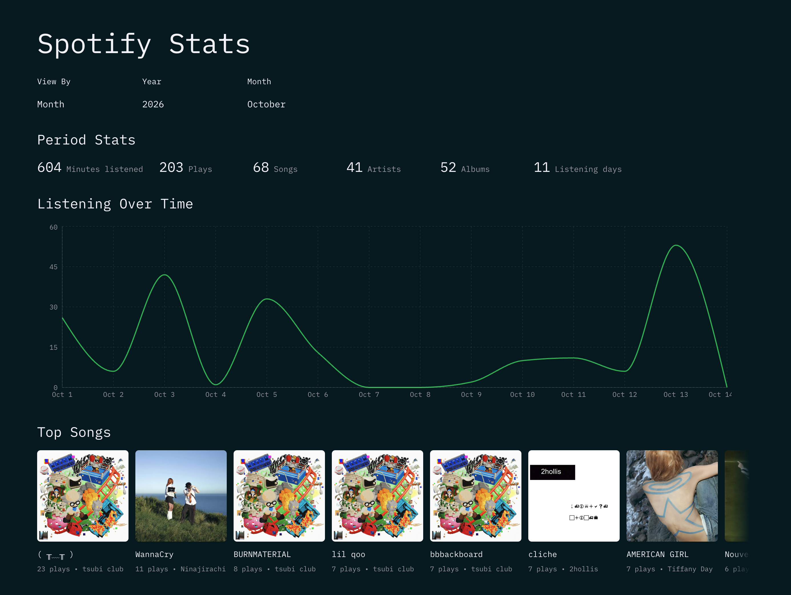
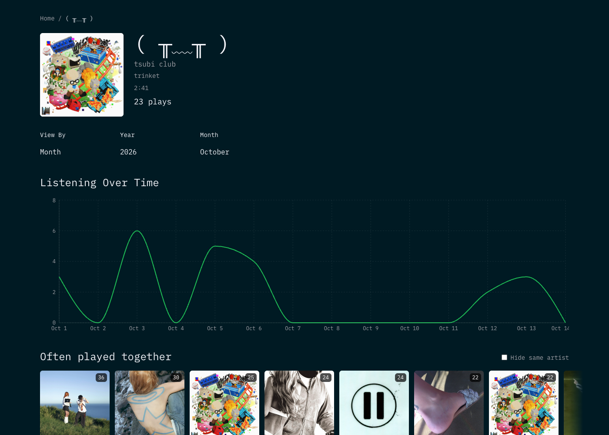
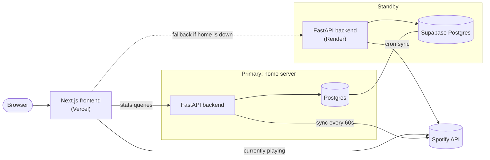

# Spotify Analytics

A dashboard for my Spotify listening history. Shows top songs, albums and
artists by day, month or year, a listening timeline, and per-track detail pages.
It uses my full Spotify data export for history and syncs new plays live.

Live: [spotify.andrewdurnford.com](https://spotify.andrewdurnford.com)





## Architecture



- `frontend/` - Next.js (App Router) + TypeScript, port `3000`
- `backend/` - FastAPI + SQLAlchemy, port `8000`
- `deploy/home/` - home-server deployment, see
  [`deploy/home/README.md`](deploy/home/README.md)
- `data/` - local Spotify export files (gitignored)

## How it works

- Plays are stored in a `streams` table. Daily rollup tables are updated
  alongside every insert so dashboard queries don't scan the full history.
- New plays come from Spotify's recently-played endpoint (completed plays only),
  synced every minute. Historical plays come from the Spotify data export, with
  skipped tracks dropped.
- "Often played together" on track pages is precomputed into rollup tables and
  rebuilt on a schedule.
- The backend runs on a home server, with Render + Supabase as a standby. The
  frontend falls back to Render if the home server doesn't respond.
- The currently-playing widget calls Spotify from a Next.js route, not the
  backend.

## Run locally

You need Docker, a Postgres database, and a Spotify app (client ID/secret and a
refresh token, see `backend/app/scripts/get_refresh_token.py`).

```bash
cp .env.example .env
# set DATABASE_URL and the SPOTIFY_* values

docker compose up --build -d
docker compose exec backend alembic upgrade head
```

Then load data. Either import a Spotify export, or set `ENABLE_LOCAL_SYNC=true`
in `.env` to record new plays as you listen:

```bash
docker compose exec backend python -m app.scripts.import_file <export.json> --commit
docker compose exec backend python -m app.scripts.import_data --metadata-only
```

Then build the rollups:

```bash
docker compose exec backend python -m app.scripts.backfill_rollups --commit
docker compose exec backend python -m app.scripts.backfill_related_tracks --commit
```

Frontend: <http://localhost:3000>. Backend: <http://localhost:8000> (`/health`).

For frontend-only development, create `frontend/.env.local`:

```bash
NEXT_PUBLIC_API_URL=http://localhost:8000
API_URL=http://localhost:8000
```

## Commands

```bash
# backend
cd backend && ruff check . && pytest

# frontend
cd frontend && npm run lint && npm test -- --run && npm run build
```

CI runs the same checks on PRs and pushes to `main`.

See [`CLAUDE.md`](CLAUDE.md) for running without Docker and code conventions,
and [`backend/MIGRATIONS.md`](backend/MIGRATIONS.md) for migrations.

## Production notes

- Set `ENVIRONMENT=production`, `CRON_SECRET` and `ALLOWED_HOSTS` (the backend
  won't start without them).
- Behind a reverse proxy, set `FORWARDED_ALLOW_IPS` so per-IP rate limiting sees
  the real client address.
- Rollups need a manual backfill after some migrations or data edits, see
  `app/scripts/backfill_rollups.py`.
